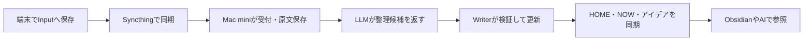

# ContextHub

AIとの作業要約や日々の思いつきをMarkdownに集め、数日後でも「現在地・次の一手・未解決」を確認するための仕組みです。Obsidianで読めるVaultを正本にし、各端末からの入力をMac miniへ同期して整理します。

現在は実験的な0.1系です。ソースは[mozuq-lab/context-hub](https://github.com/mozuq-lab/context-hub)で管理します。

## できること

- メモ・AI作業要約を先に原文として保存し、出典と日時を保持する。昨日の会議を今日書くときは、[出来事の日付](docs/architecture.md#原文と生成物)を付けて経緯や現在地をその日の順に並べる。
- 前に書いたメモへの追記は[続き](docs/architecture.md#原文と生成物)として書き、前のメモを残したままつなぐ。プロジェクトは前のメモから引き継ぎ、整理では前のメモを前提として読む。
- AIが分類・要約・関連候補を返し、コードが検証してアイデアやプロジェクトのNOWを更新する。訂正のない100文字以下のメモは言い換えず、[本人の言葉のまま](docs/architecture.md#原文と生成物)示す。
- HOMEから受領・整理状態を確認し、[検索](docs/operations.md#普段の確認)（プロジェクト・種類・期間での絞り込みと続きの表示）や別AI向けのコンテキスト出力を使う。検索で見つけた記録だけを[束ねて](docs/operations.md#普段の確認)、出典と方針付きで別のAIへ渡すこともできる。
- メモに紛れたAPIキー・パスワードなどを、整理用のモデルや別AI向けのcontextへ渡す前に[伏せ字](docs/operations.md#秘密情報らしい文字列を伏せる)にする（原文は変えない）。
- 同じ話かもしれない[似ているアイデア](docs/operations.md#似ているアイデアを束ねる)をAIを使わずに見つけ、本人の判断で束ねる。
- 直近7日の[ふりかえり](docs/project-lifecycle.md#ふりかえりreviewmd)で、動いたプロジェクト・現在地の変化・持ち越しの未解決を確認する。
- 設定で有効にすると、たまったメモをAIが週に1回まとめて読み直し、メモ同士のつながり・考えの変化・止まっている意図・次の一手の提案・問いを、根拠のメモ付きで[今週の気づき](docs/weekly-synthesis.md)としてHOMEとふりかえりの先頭に出す（既定では無効）。アプリで付けた反応（役に立った・的外れ）と問いへの答えを、次の週の読み直しに使う。
- プロジェクトごとの[経緯（HISTORY.md）](docs/project-lifecycle.md#経緯historymd)で、月ごとの入力・現在地の移り変わり・完了報告・状態の切り替えを通して読む。
- プロジェクトごとの[資料（REFERENCES.md）](docs/project-lifecycle.md#資料referencesmd)で、参考資料に分類されたメモと本文のURLを新しい順に見返す（URLの中身は取得しない）。
- 本人が登録した人ごとに、名前が出てくる記録と、プロジェクトをまたいだ未完了の次の一手・未解決を[一覧にする](docs/operations.md#人ごとの見返し)（名前の一致はAIを使わず判定し、登録した人だけを対象にする）。
- 止まっているプロジェクトをHOMEで見つけ、本人の操作で[休止・完了](docs/project-lifecycle.md)に切り替える。
- 同じものを指して別々にできた2つのプロジェクトを、本人の確認で[1つにまとめる](docs/project-lifecycle.md#プロジェクトの統合)（原文と記録は動かさず、取り消せる）。
- プロジェクトの名前・別名・キーワードを、本人の確認で[安全に書き換える](docs/project-lifecycle.md#名前別名キーワードの手入れ)。手で壊した定義は、ファイルと項目をHOMEと`doctor`で示す。
- 進行中のプロジェクトの次の一手を、HOMEで[まとめて確認](docs/work-records.md#homeの次の一手)する。どのプロジェクトにも結び付いていないメモのタスク候補とAIの提案、プロジェクトを決めずに追加した行動も、[プロジェクト未定の次の一手](docs/work-records.md#プロジェクト未定の次の一手)として示す（行動には期日・見直す日・手間の目安も付けられる）。
- NOWの次の一手・未解決を、本人の報告で[完了・解決](docs/work-records.md)にする。
- AIが読み違えた次の一手・未解決を、理由を添えて[誤りとして外し](docs/work-records.md#誤りとして外すaiの読み違いの報告)、元のメモを読み直させる（完了・解決とは数えない）。
- 次の一手・未解決に本人が[期日と次に見直す日](docs/work-records.md#期日と次に見直す日)を付け、HOMEで「期限切れ・今日・7日以内」を先に確認する。設定で有効にすると、期日を[カレンダーに読み込めるファイル](docs/work-records.md#期日をカレンダーに出す)（iCalendar）にも書き出す。
- 毎週・毎月のように繰り返す作業を[定例](docs/work-records.md#定例繰り返す期日)にし、今回を完了すると期日が次の回へ進む（項目は残る）。
- 次の一手・未解決に本人が[手間の目安](docs/work-records.md#手間の目安)（15分ほど・1時間ほど・半日以上）を付け、空いた時間に合う項目を選ぶ。
- 次の一手・未解決に本人が[場所・道具の札](docs/work-records.md#場所道具の札)（家・外出先・PC・電話など、語彙は本人が決める）を付け、アプリで今いる場所や手元の道具でできる項目に絞り込む。
- 人に頼んだこと・返事を待っていることに[連絡待ち](docs/work-records.md#連絡待ち)の印（相手・頼んだ日）を付け、HOMEの「次の一手」から分けてまとめる。見直す日が来たら確認として先頭に出す。
- 今はやらない項目を[いつかやる](docs/work-records.md#いつかやる)へ移し、休止中のプロジェクト・本人が置いたアイデアと一緒に、最後に見直した日の古い順に並べる。30日以上見直していないものを数え、「始める・そのまま・やめる」を本人が選ぶ。
- [週次レビュー](docs/project-lifecycle.md#週次レビュー)で、確認待ち・プロジェクト未定の行動・次の一手がないプロジェクトと長く残っている項目・停滞・連絡待ち・期日・いつかやるを順に点検し、その場で判断する。点検の一覧はモデルを使わずに作り、見直した日は本人の報告だけで記録して、HOMEに最後の見直しからの日数を示す。
- [記録に聞く](docs/ask.md)で、問いにVaultの記録だけを根拠に答えさせる。答えの文ごとに元のメモの引用が付き、引用が記録と一致しない文はコードが落とす。
- プロジェクトを明示して保存したメモから、片付いた可能性のある次の一手・未解決をAIが引用付きで[「片付いたかも」](docs/work-records.md#片付いたかもaiが見つける完了解決の候補)として示す（確定は本人の報告だけ）。
- 設定したローカルリポジトリのコミット件名から[作業記録の下書き](docs/work-records.md#コミット履歴からの作業記録の下書き)を作り、本人の確認後に入力にする（既定は無効）。
- 原文を残した訂正と、本人操作によるプロジェクト案・知識候補の承認を扱う。同じ対象を指すプロジェクト案は[1件にまとめて](docs/candidate-review.md#同じ対象を指すプロジェクト案)示す。
- [採用先付きの知識・方針](docs/policies.md)を共通/プロジェクトへ保存し、有効方針の読取・適用停止・AI接続用の設定差分を用意する。採用から日数が過ぎた方針はHOMEで[見直し](docs/policies.md)に出し、本人が「まだ有効」か適用停止かを決める。
- Codex・Claude Codeから同期済みVaultを参照し、作業結果をInputへ追加する。
- Mac・Androidの[専用アプリ（ContextHub Flutter）](#macandroidアプリ)から、整理結果の閲覧・メモ追加・候補の採用/却下を行う。

全会話の自動収集、専用Webアプリ・iOSアプリ（Mac・Androidアプリは別リポジトリ）、URLの自動取得、音声・画像処理、外部タスクの自動実行は含みません。

## まずデモを試す

Node 24とnpmを使います。リポジトリを取得したディレクトリで実行してください。

```sh
git clone https://github.com/mozuq-lab/context-hub.git
cd context-hub
npm ci
npm test
npm run demo
```

デモは架空のsample-vaultを`.demo/`へコピーし、MockLlmで受付・整理・検索・訂正・プロジェクト承認を検証します。APIキー、Bot、OpenClaw、実Vaultは使いません。入力と生成結果は`.demo/vault/`を開いて読めます。

## 実際の構成



| 用途 | 必要なもの |
|---|---|
| ローカルデモ・開発 | Node 24、npm |
| 実AIでの整理 | OpenClaw、利用者が設定したモデルと認証 |
| 端末間の入力・返送 | 常時稼働するMac mini、Syncthing互換の同期環境 |
| モバイル入力 | ObsidianとQuickAdd、共有フォルダーへのアクセス |
| Mac・Androidアプリでの閲覧・入力（任意） | [ContextHub Flutter](https://github.com/mozuq-lab/context-hub-flutter-client)、同期済みVault。ビルド済みアプリは配布していないため、FlutterとXcode/Android SDKで各自ビルド |
| CLIバックアップ例 | macOSのsh、tar、BSD stat。暗号化する場合は[age](docs/operations.md#バックアップを暗号化する任意) |

ファイル同期・QuickAdd・再起動・復旧にはMac mini/Mac/Androidでの確認実績があります。OS、同期アプリ、Obsidian/QuickAdd、OpenClawの版や権限が異なる環境では、サンプルから確認してください。ほかのOSでの本番運用を保証するものではありません。

## Mac・Androidアプリ

[mozuq-lab/context-hub-flutter-client](https://github.com/mozuq-lab/context-hub-flutter-client)は、このVaultを読むためのMac（Apple Silicon、macOS 12以降）・Android用のクライアントアプリです。別リポジトリで管理しています。Obsidianを使わずに、次の操作ができます。

- プロジェクトの「現在地・次の一手・未解決・提案」と、元のメモ・出典の確認
- 最近のメモ・アイデアの一覧、本文検索、出典付きcontextのコピー
- 選んだ記録だけを「文脈かご」に集め、出典と方針付きでまとめてコピー（`ctx bundle`と同じ形）
- メモ・AI作業要約のInputへの追加
- 選択肢を選びながら記録・壁打ちを進め、確認したまとめをメモとして追加する「選んで深掘り」（任意）
- プロジェクト案・知識・方針の候補の採用・却下・適用停止の依頼
- 記録に聞く、定例の今回の完了・見送り、ピン留め・ひな形などの好みを端末間でそろえる
- メモの続きを書く、次の一手に手間の目安を付けて空いた時間に合うものを絞り込む
- 次の一手・未解決に場所・道具の札を付け、札（札なしを含む）で絞り込む。札の語彙を端末の間でそろえる
- 次の一手・未解決を連絡待ちにする（相手・頼んだ日・見直す日）・外す
- 次の一手・未解決・アイデアを「いつかやる」へ移す・置く、「いつかやる」の一覧で始める・そのまま・やめるを選ぶ
- 週次レビューを段ごとに進め、各段の項目をその場で操作し、最後に「見直した」と報告する

アプリは同期済みVaultのファイルを読み、依頼をInputへ新しく保存するだけです。「選んで深掘り」を使う場合だけ、本人が設定したClaudeのAPIキーで、端末から問いとまとめの作成をClaude APIへ依頼します。同期はSyncthingなど、受領・整理・承認の反映はこの本体が行います。候補の確認待ち一覧は本体の`dashboard`または`cycle`が生成するため、アプリの0.3.0は候補一覧と採用先付き方針に対応した本体と組み合わせて使います。

クライアントは対応する本体のcommitをsubmoduleで固定し、protocolの互換性をテストしています。本体のCIでも、クライアントの既定ブランチを取得してDartテストを実行し、fixtureとの形式差分を警告として示します（失敗しても本体のPRは止めません。[開発と検証](docs/development.md#ciと公開物)）。ビルド済みアプリは配布していないため、ビルド方法と使い方はクライアントのREADMEを参照してください。

## 利用と導入

- [構成・データ・承認の境界](docs/architecture.md)
- [個人設定を分離した導入手順](docs/setup.md)
- [取得済みリポジトリから安全に更新する](docs/deployment.md)
- [停止・同期・バックアップ・復元](docs/operations.md)
- [Codex・Claude CodeからVaultを参照する](docs/prompts/vault-access.md)
- [AI作業要約の形式](docs/prompts/handoff-summary.md)
- [選択肢を選んで記録・壁打ちする（選んで深掘り）](docs/prompts/guided-capture.md)
- [候補の確認待ちを使う](docs/candidate-review.md)
- [プロジェクトの状態・統合・ふりかえり・経緯・資料](docs/project-lifecycle.md)
- [週次の統合（今週の気づき）](docs/weekly-synthesis.md)
- [記録に聞く](docs/ask.md)
- [開発と検証](docs/development.md)
- [Mac・Androidアプリ（別リポジトリ）](https://github.com/mozuq-lab/context-hub-flutter-client)

実AIの利用枠や費用はモデルの契約によります。同期は双方向の変更・削除も伝播するため、バックアップは別に用意します。個人設定、トークン、実Vault、全会話履歴をこのリポジトリへ入れないでください。

## コントリビュートと報告

[CONTRIBUTING.md](CONTRIBUTING.md)と[SECURITY.md](SECURITY.md)を参照してください。初期公開ではサポート範囲と確認済みの版を明示し、必要な拡張を小さく検証していきます。

## ライセンス

MIT Licenseで提供します。利用・改変・再配布の条件は[LICENSE](LICENSE)を参照してください。依存パッケージと外部アプリにはそれぞれの利用条件が適用されます。
