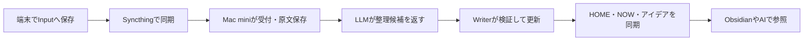

# ContextHub

AIとの作業要約や日々の思いつきをMarkdownに集め、数日後でも「現在地・次の一手・未解決」を確認するための仕組みです。Obsidianで読めるVaultを正本にし、各端末からの入力をMac miniへ同期して整理します。

現在は実験的な0.1系です。ソースは[mozuq-lab/context-hub](https://github.com/mozuq-lab/context-hub)で管理します。

## できること

- メモ・AI作業要約を先に原文として保存し、出典と日時を保持する。
- AIが分類・要約・関連候補を返し、コードが検証してアイデアやプロジェクトのNOWを更新する。
- HOMEから受領・整理状態を確認し、検索や別AI向けのコンテキスト出力を使う。
- 原文を残した訂正と、本人操作によるプロジェクト案・知識候補の承認を扱う。
- [採用先付きの知識・方針](docs/policies.md)を共通/プロジェクトへ保存し、有効方針の読取・適用停止・AI接続用の設定差分を用意する。
- Codex・Claude Codeから同期済みVaultを参照し、作業結果をInputへ追加する。

全会話の自動収集、専用Web/モバイルアプリ、URLの自動取得、音声・画像処理、外部タスクの自動実行は含みません。

## まずデモを試す

Node 24とnpmを使います。リポジトリを取得したディレクトリで実行してください。

```sh
git clone https://github.com/mozuq-lab/context-hub.git
cd context-hub
npm ci
npm test
npm run demo
```

デモは架空のsample-vaultを`.demo/`へコピーし、MockLlmで受付・整理・検索・訂正・プロジェクト承認を検証します。APIキー、Bot、OpenClaw、実Vaultは使いません。入力と生成結果は`.demo/vault/`を開いて読めます。

## 実際の構成



| 用途 | 必要なもの |
|---|---|
| ローカルデモ・開発 | Node 24、npm |
| 実AIでの整理 | OpenClaw、利用者が設定したモデルと認証 |
| 端末間の入力・返送 | 常時稼働するMac mini、Syncthing互換の同期環境 |
| モバイル入力 | ObsidianとQuickAdd、共有フォルダーへのアクセス |
| CLIバックアップ例 | macOSのsh、tar、BSD stat |

ファイル同期・QuickAdd・再起動・復旧にはMac mini/Mac/Androidでの確認実績があります。OS、同期アプリ、Obsidian/QuickAdd、OpenClawの版や権限が異なる環境では、サンプルから確認してください。ほかのOSでの本番運用を保証するものではありません。

## 利用と導入

- [構成・データ・承認の境界](docs/architecture.md)
- [個人設定を分離した導入手順](docs/setup.md)
- [停止・同期・バックアップ・復元](docs/operations.md)
- [Codex・Claude CodeからVaultを参照する](docs/prompts/vault-access.md)
- [AI作業要約の形式](docs/prompts/handoff-summary.md)
- [開発と検証](docs/development.md)

実AIの利用枠や費用はモデルの契約によります。同期は双方向の変更・削除も伝播するため、バックアップは別に用意します。個人設定、トークン、実Vault、全会話履歴をこのリポジトリへ入れないでください。

## コントリビュートと報告

[CONTRIBUTING.md](CONTRIBUTING.md)と[SECURITY.md](SECURITY.md)を参照してください。初期公開ではサポート範囲と確認済みの版を明示し、必要な拡張を小さく検証していきます。

## ライセンス

MIT Licenseで提供します。利用・改変・再配布の条件は[LICENSE](LICENSE)を参照してください。依存パッケージと外部アプリにはそれぞれの利用条件が適用されます。
